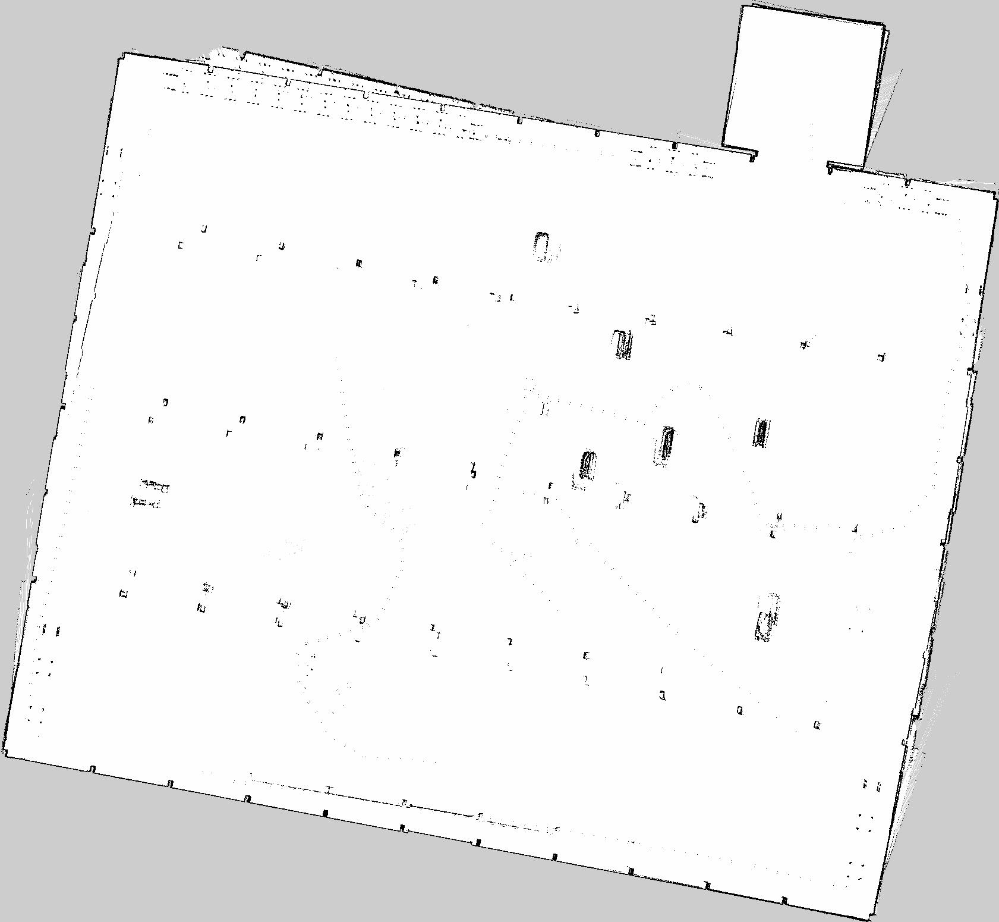

# VLA-Enabled Mobile Manipulator (Isaac Sim + ROS 2 Jazzy)

Autonomous mobile manipulation pipeline combining a **Nova Carter** base and a **robotic manipulator** for semantic pick-and-place in unknown environments.

## System Stack
- **OS & Middleware:** Ubuntu 24.04 LTS, ROS 2 Jazzy
- **Simulator:** NVIDIA Isaac Sim 6.2.0
- **Hardware Baseline:** NVIDIA RTX 5060 Ti (16 GB VRAM)

<p align="center">
  <br>
  <em>NVIDIA Isaac Sim 6.2.0 running the custom warehouse_scene.usda with Nova Carter.</em>
</p>

## Current Status (`v0.1.0`)
- [x] Nova Carter teleoperation and working `/odom` + `/tf` Action Graphs (`odom -> base_link`)
- [x] Real-time 2D SLAM (`slam_toolbox`) using single `front_RPLidar` (`/sim_2d_lidar/scan`)
- [x] Saved warehouse occupancy grid (`maps/warehouse_map.pgm`)

<p align="center">
  <br>
  <em>2D occupancy grid generated with slam_toolbox using Nova Carter's front RPLidar.</em>
</p>

## Quick Start (SLAM Baseline)
1. Open `sim/scenes/warehouse_scene.usda` in NVIDIA Isaac Sim 6.2.0 (requires local NVIDIA Isaac Sim 6.2 asset pack) and press **Play**.
2. Launch `slam_toolbox` using the repository config:
   ```bash
   ros2 launch slam_toolbox online_async_launch.py \
     use_sim_time:=True \
     slam_params_file:=$(pwd)/config/slam/nova_slam_params.yaml
   ```
3. Drive the robot by publishing velocity commands to `/cmd_vel` (tested with a gamepad via `teleop_twist_joy`; `teleop_twist_keyboard` also works).

## License & Third-Party Assets
Original code and configurations in this repository are licensed under the [Apache-2.0 License](LICENSE). NVIDIA Isaac Sim environments and robot USD assets remain under their respective licenses and are not redistributed here.

## Author
**Anupam Tudu** — [GitHub](https://github.com/anupamtudu) · [LinkedIn](https://www.linkedin.com/in/anupamtudu/)