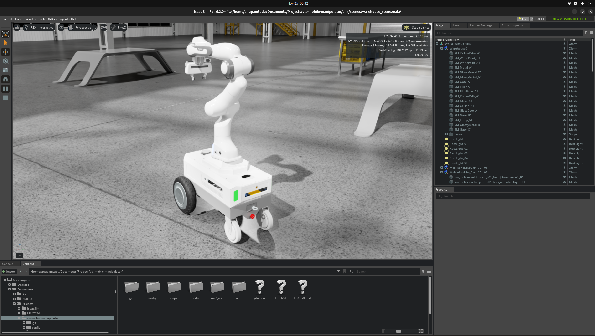
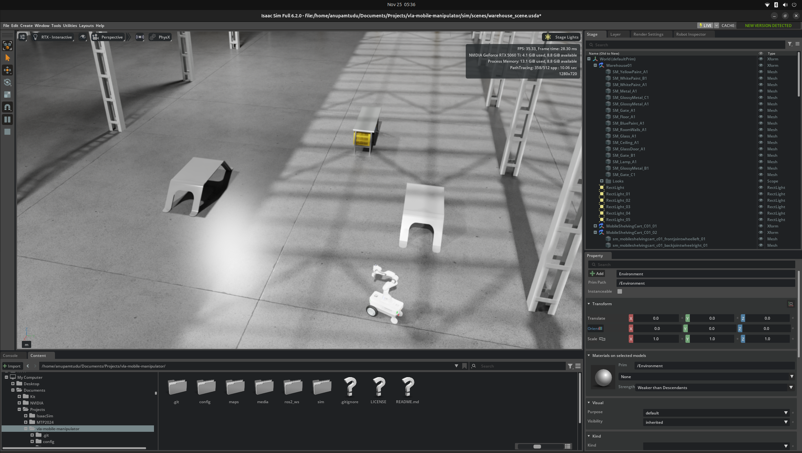
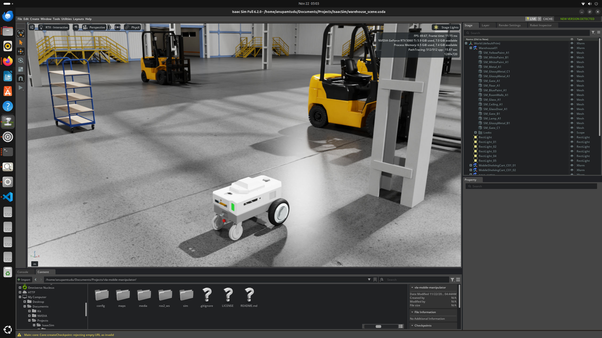

# VLA-Enabled Mobile Manipulator (Isaac Sim + ROS 2 Jazzy)

Autonomous mobile manipulation pipeline combining a **Nova Carter** base and a **robotic manipulator** for semantic pick-and-place in unknown environments.

## System Stack
- **OS & Middleware:** Ubuntu 24.04 LTS, ROS 2 Jazzy
- **Simulator:** NVIDIA Isaac Sim 6.2.0
- **Hardware Baseline:** NVIDIA RTX 5060 Ti (16 GB VRAM)

## Roadmap

| Version | Milestone | Target Capabilities | Status |
| :--- | :--- | :--- | :--- |
| **`v0.1.0`** | **Base & 2D SLAM** | Nova Carter teleop, `/odom` + `/tf` graphs, `slam_toolbox` mapping | Completed |
| **`v0.2.0`** | **Manipulator & C++17 Core** | Franka mount, unified `/joint_states` + `/joint_command`, URDF/TF tree, C++17 joint controller (`ament_cmake`) | In Progress |
| **`v0.3.0`** | **Autonomous Navigation** | Nav2 integration, localization, and obstacle-aware goal execution | Planned |
| **`v0.4.0`** | **Arm Motion Planning** | MoveIt2 setup, collision-aware trajectory execution, and grasp planning | Planned |
| **`v0.5.0`** | **Perception & Semantic Autonomy** | RGB-D object localization and closed-loop pick-and-place (VLA/perception-guided) | Planned |

## Progress Log

### `v0.2.0` — Manipulator & C++17 Core *(In Progress)*
- [x] Mounted Franka Panda (`panda_link0`) onto Nova Carter (`chassis_link`) via `FixedJoint` at `(X: -0.19 m, Z: 0.48 m)`
- [x] Configured multi-height pick-and-place warehouse workspace (two low arched tables + one taller packing workbench)
- [x] Wired unified ROS 2 `/joint_states` (16-DOF) and `/joint_command` Action Graph (`/World/ROS_Franka_Joints`) for Nova Carter + Franka Panda
- [ ] Build `mobile_manipulator_description` (combined URDF/Xacro + `robot_state_publisher` for live `panda_*` TF frames)
- [ ] Build `mobile_manipulator_control` (initial C++17 `ament_cmake` joint control node with YAML joint-limit clamping)

<p align="center">
  <br>
  <em>Franka Panda 7-DoF arm mounted on Nova Carter's top deck in Isaac Sim 6.2.0.</em>
</p>

<p align="center">
  <br>
  <em>Multi-height pick-and-place environment with two low arched tables and one taller packing workbench.</em>
</p>

### `v0.1.0` — Base & 2D SLAM
- [x] Nova Carter teleoperation and working `/odom` + `/tf` Action Graphs (`odom -> base_link`)
- [x] Real-time 2D SLAM (`slam_toolbox`) using single `front_RPLidar` (`/sim_2d_lidar/scan`)
- [x] Saved warehouse occupancy grid (`maps/warehouse_map.pgm`)

<p align="center">
  <br>
  <em>NVIDIA Isaac Sim 6.2.0 running the custom warehouse_scene.usda with Nova Carter.</em>
</p>

<p align="center">
  <br>
  <em>2D occupancy grid generated with slam_toolbox using Nova Carter's front RPLidar.</em>
</p>

## Quick Start

1. **Launch Simulation:** Open `sim/scenes/warehouse_scene.usda` in NVIDIA Isaac Sim 6.2.0 (requires local NVIDIA Isaac Sim 6.2 asset pack) and press **Play**.

2. **Verify Manipulator Joint Bridge (`/joint_states` & `/joint_command`):**
   ```bash
   # Inspect live 16-DOF feedback (Nova Carter base + 9 Franka arm/gripper joints)
   ros2 topic echo /joint_states --once

   # Send a test arm pose and close the gripper
   ros2 topic pub --times 5 -r 10 /joint_command sensor_msgs/msg/JointState \
     "{name: ['panda_joint1', 'panda_joint2', 'panda_joint3', 'panda_joint4', 'panda_joint5', 'panda_joint6', 'panda_joint7', 'panda_finger_joint1', 'panda_finger_joint2'], \
       position: [0.5, -0.785, 0.0, -2.356, 0.0, 1.571, 0.785, 0.0, 0.0]}"
   ```

3. **Run 2D SLAM:** Launch `slam_toolbox` using the repository config:
   ```bash
   ros2 launch slam_toolbox online_async_launch.py \
     use_sim_time:=True \
     slam_params_file:=$(pwd)/config/slam/nova_slam_params.yaml
   ```

4. **Teleoperate Base:** Drive the robot by publishing velocity commands to `/cmd_vel` (tested with a gamepad via `teleop_twist_joy`; `teleop_twist_keyboard` also works).

## License & Third-Party Assets
Original code and configurations in this repository are licensed under the [Apache-2.0 License](LICENSE). NVIDIA Isaac Sim environments and robot USD assets remain under their respective licenses and are not redistributed here.

## Author
**Anupam Tudu** — [GitHub](https://github.com/anupamtudu) · [LinkedIn](https://www.linkedin.com/in/anupamtudu/)